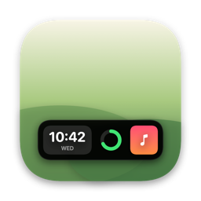
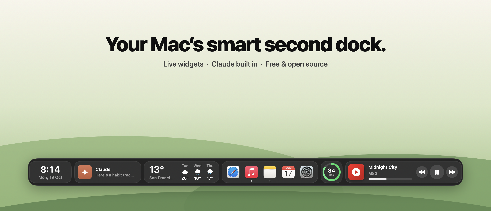
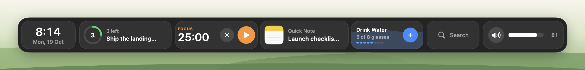
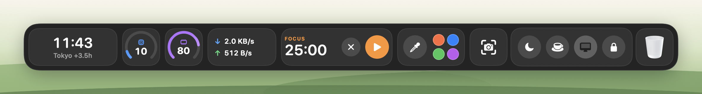
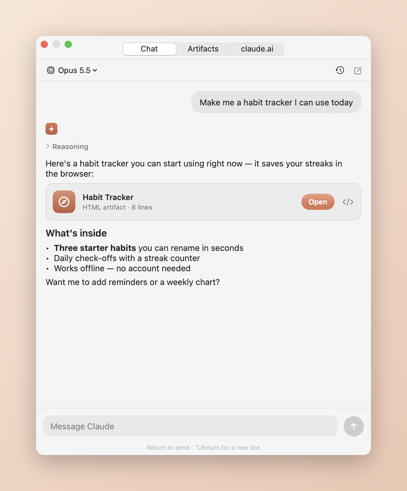
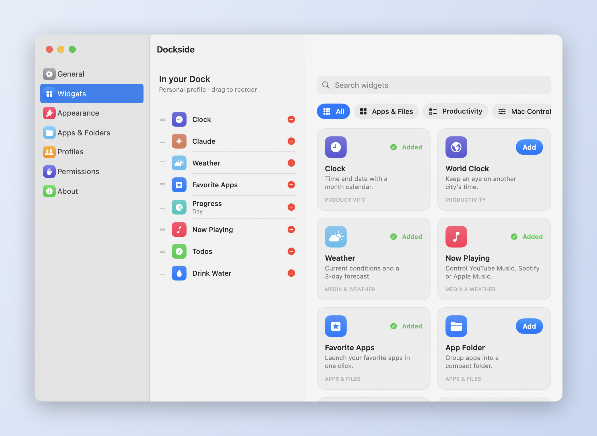

<div align="center">



# Dockside

**Your Mac’s smart second dock — live widgets, Claude built in, free and open source.**

[](https://github.com/shreyansa98/Dockside/releases/latest)
[](https://github.com/shreyansa98/Dockside/releases)
[](https://github.com/shreyansa98/Dockside/stargazers)
[](https://github.com/shreyansa98/Dockside/actions/workflows/ci.yml)


[](LICENSE)


[**Download the beta**](https://github.com/shreyansa98/Dockside/releases/latest) · [Features](#-34-widgets) · [Install](#-install) · [Permissions](#-permissions--privacy) · [Contribute](#-contributing)

<br>



</div>

<br>

Your Mac’s Dock launches apps. **Dockside runs your day.** It’s a beautiful second dock that sits just above the one you already have, packed with *live* widgets: music, weather, todos, focus timers, system stats, your clipboard, quick toggles — and **Claude**, one keystroke away.

It hides until you need it, slides in when your pointer touches the bottom of the screen, and gets out of the way the moment you move on.

> [!NOTE]
> **Dockside is in public beta.** It’s already a daily driver, but expect rough edges. [Report anything odd](https://github.com/shreyansa98/Dockside/issues/new/choose) — every issue makes the next release better.

## ✨ Why Dockside

|  |  |
|---|---|
| ⚡️ **Native and tiny** | 100% Swift and SwiftUI. An 11 MB universal app for Apple Silicon and Intel — no Electron, no web views for the dock itself. |
| ✳️ **Claude built in** | Ask Claude anything with <kbd>⌃</kbd><kbd>⌥</kbd><kbd>C</kbd>. Web pages, charts and SVGs it creates open as live **artifacts** right inside Dockside, and your claude.ai artifacts are a click away. |
| 🎵 **Your music, your service** | YouTube Music (in Chrome, Brave, Edge or Safari), Spotify and Apple Music, with artwork, progress and controls. |
| 🫥 **Invisible until needed** | Auto-hides, reveals on a bottom-edge hover, and never covers the macOS Dock. |
| 🎨 **Make it yours** | 34 widgets, profiles for Work/Personal/whatever, 4 themes, 7 accents, 3 sizes, top or bottom, free placement. |
| 🔒 **Private by design** | No account, no analytics, no tracking. Your data stays in a folder on your Mac. [Every network call is listed below.](#-permissions--privacy) |
| 🛠 **Hackable** | A widget is one SwiftUI view. [Add your own](CONTRIBUTING.md#add-a-widget-in-5-steps) in an afternoon and send a PR. |

## 🧩 34 widgets

| Category | Widgets |
|---|---|
| **AI** | Claude — chat, artifacts and claude.ai |
| **Media & weather** | Now Playing (YouTube Music · Spotify · Apple Music) · Weather with 3-day forecast |
| **Apps & files** | Favorite Apps · App Folders · App Switcher · Search (apps, files, web, math, *Ask Claude*) · Downloads · File Shelf · Bookmarks · Trash |
| **Productivity** | Clock with calendar · World Clock · Calendar & meetings (one-click *Join*) · Reminders · Todos · Pomodoro · Drink Water · Day/Week/Month/Year Progress · Quick Note |
| **Mac controls** | CPU · Memory · Battery · Storage · Network speed · Quick Toggles (Dark Mode, Keep Awake, Desktop Icons, Lock) · Volume · Clipboard History · Screenshots · Voice Memo |
| **Creator & utility** | Emoji · Color Picker · Calculator & Unit Converter |
| **Developer** | GitHub profile & repos |

Switch between whole layouts with **profiles**:




## ✳️ Claude, right in your dock



Click the Claude widget or press <kbd>⌃</kbd><kbd>⌥</kbd><kbd>C</kbd> from any app.

- **Chat** — streaming replies from the Claude API with Opus 5.5 by default (Sonnet 5.5, Haiku 5.5 and Fable 5.1 in the model menu), readable reasoning, and saved history.
- **Artifacts** — when Claude writes a web page, chart, SVG or document, it becomes a live artifact you can open, keep, copy or open in your browser.
- **claude.ai** — your own claude.ai account, with your chats and [artifacts](https://claude.ai/artifacts), in a native panel.
- **Search** — type anything in the Search widget and pick *Ask Claude*.

Chat uses your own [Anthropic API key](https://console.anthropic.com/settings/keys), stored in the macOS Keychain. API usage is billed by Anthropic separately from a Claude Pro/Max subscription; the claude.ai tab uses your normal subscription.

<br clear="right">

## 📦 Install

### Download (recommended)

1. Download **[Dockside-0.1.0-beta.dmg](https://github.com/shreyansa98/Dockside/releases/latest)** from the latest release.
2. Open it and drag **Dockside** into **Applications**.
3. Open Dockside from Applications. A dock icon appears in your menu bar and Dockside peeks in at the bottom of your screen.

> [!IMPORTANT]
> **First launch: “Apple could not verify Dockside…”**
> The beta isn’t notarized by Apple yet (that requires a paid developer account), so macOS asks you to confirm once:
> 1. Open Dockside, then click **Done**.
> 2. Go to **System Settings ▸ Privacy & Security**, scroll down and click **Open Anyway** next to Dockside.
> 3. Confirm with your password or Touch ID.
>
> Prefer Terminal? `xattr -dr com.apple.quarantine /Applications/Dockside.app`
>
> You can read every line of the code in this repo, or [build it yourself](#build-from-source). Each release lists the DMG’s SHA-256 checksum.

### Requirements

- macOS 14 Sonoma or later (tested on macOS 15 Sequoia)
- Apple Silicon or Intel Mac
- For Claude chat: an Anthropic API key (optional)

### Getting started in 30 seconds

| Do this | To |
|---|---|
| Push your pointer against the **bottom edge** of the screen | Reveal Dockside |
| <kbd>⌃</kbd><kbd>⌥</kbd><kbd>D</kbd> | Keep Dockside open (press again to release) |
| <kbd>⌃</kbd><kbd>⌥</kbd><kbd>C</kbd> | Open Claude |
| **Right-click** any widget | Move it, remove it, switch profile |
| **Click** a widget | Open its expanded view |
| **Scroll** sideways on the dock | See widgets that don’t fit on screen |
| Menu bar ▸ **Customize Widgets…** | Add widgets from the gallery |



### Build from source

```sh
git clone https://github.com/shreyansa98/Dockside.git
cd Dockside
./build.sh            # universal build, ad-hoc signed, installed to /Applications
./build.sh --dmg      # also packages build/Dockside-<version>-beta.dmg
```

Needs the Xcode Command Line Tools (`xcode-select --install`). No Xcode project, no dependencies — just Swift Package Manager.

### Updating and uninstalling

- **Update:** download the new DMG and replace the app. Your settings are kept.
- **Uninstall:** quit Dockside from its menu bar icon, then delete:
  - `/Applications/Dockside.app`
  - `~/Library/Application Support/Dockside/` (settings, chats, artifacts)
  - the Keychain item `app.dockside.mac.anthropic` (only if you saved a Claude API key)

## 🔐 Permissions & privacy

**Dockside needs no permissions to run.** The dock, clock, weather, apps, todos, notes, system stats and most widgets work with zero prompts. macOS asks for a permission only the first time you use a widget that needs it, and you can say no — only that widget is affected.

| Permission (macOS prompt) | Asked when you… | Used for | Required? |
|---|---|---|---|
| **Automation → your browser** (Chrome, Brave, Edge, Safari) | play YouTube Music with the Now Playing widget | reading the song and pressing play/pause/next in the YouTube Music tab | Only for YouTube Music |
| **Automation → Spotify / Music** | use Now Playing with Spotify or Apple Music | reading the current track and controlling playback | Only for those players |
| **Automation → System Events** | tap the Dark Mode toggle | switching Light/Dark appearance | Only for that toggle |
| **Automation → Finder** | choose *Empty Trash* | emptying the Trash | Only for that action |
| **Calendars** | click *Connect calendar* | showing upcoming events and *Join* links | Only for Calendar |
| **Reminders** | click *Connect Reminders* | showing and completing reminders | Only for Reminders |
| **Microphone** | start a Voice Memo | recording memos to `~/Music/Dockside Memos` | Only for Voice Memo |
| **Downloads folder** | open the Downloads widget | listing your recent downloads | Only for Downloads |
| **Desktop folder** | open the Screenshots widget | listing recent screenshots (macOS saves them to Desktop) | Only for Screenshots |
| **Screen Recording** | capture with the Screenshots widget | taking the screenshot | Only for capturing |
| **Accessibility** | control YouTube Music while the browser blocks scripting (see below) | sending play/pause/next media keys | Only as a fallback |
| **Keychain** | save a Claude API key | storing the key securely | Only for Claude chat |

**Optional browser setting for YouTube Music.** For artwork, a progress bar and precise controls, turn on **Allow JavaScript from Apple Events** — Chrome/Brave/Edge: *View ▸ Developer*; Safari: *Settings ▸ Advanced ▸ Show features for web developers*, then *Develop ▸ Allow JavaScript from Apple Events*. Without it, Dockside reads the tab title and uses media keys.

**What leaves your Mac — the complete list:**

| Service | When | What is sent |
|---|---|---|
| [Open-Meteo](https://open-meteo.com) | Weather widget | approximate coordinates (or your typed city) |
| [ipwho.is](https://ipwho.is) | Weather widget, only if no city is set | your IP address, to find your city |
| Anthropic API | You send a Claude chat message | your message and the chat history, with your API key |
| claude.ai | You open the claude.ai tab | whatever you do there, as in any browser |
| GitHub API | GitHub widget | the username you entered |
| Google favicon service | Bookmarks widget | the domains of your bookmarks |
| Album-art hosts (Spotify, YouTube) | Now Playing | a request for the current cover image |

No analytics. No crash reporting. No account. Clipboard history is kept in memory only and skips copies that password managers mark as private.

## 🗺 Roadmap

- [ ] Signed & notarized builds (no more *Open Anyway*)
- [ ] Homebrew cask: `brew install --cask dockside`
- [ ] Auto-update via Sparkle
- [ ] Multi-display support (dock per screen)
- [ ] Drag-and-drop widget reordering right on the dock
- [ ] Widget plugin API
- [ ] More integrations: Linear, Notion, Stripe, Home Assistant
- [ ] Localization

Have an idea? [Suggest a widget](https://github.com/shreyansa98/Dockside/issues/new?template=widget_idea.yml) or upvote one with a 👍.

## 🤝 Contributing

Dockside is built in the open and PRs are very welcome — from typo fixes to whole new widgets.

1. **Fork** this repo and create a branch.
2. `./build.sh` to build and run your copy.
3. Open a **pull request** — CI builds it automatically.

Start with **[CONTRIBUTING.md](CONTRIBUTING.md)** (including *Add a widget in 5 steps*) and look for issues labelled [`good first issue`](https://github.com/shreyansa98/Dockside/labels/good%20first%20issue). Please follow our [Code of Conduct](CODE_OF_CONDUCT.md); security reports go through [SECURITY.md](SECURITY.md).

## ⭐ Like it?

If Dockside makes your Mac a little nicer, **star the repo** — it’s the best way to help others find it — and share it with a friend who loves a tidy desktop.

[](https://star-history.com/#shreyansa98/Dockside&Date)

## 📄 License

[MIT](LICENSE) — free for personal and commercial use.

<sub>Dockside is an independent open-source project and is not affiliated with Apple, Anthropic, Google, YouTube or Spotify. Claude is a trademark of Anthropic; all other names are trademarks of their respective owners.</sub>
